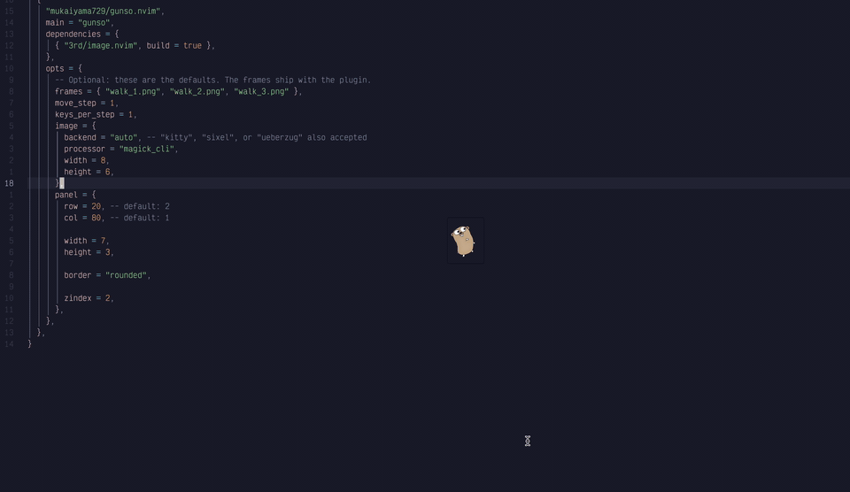

# gunso.nvim

A small animated walking companion for Neovim. Gunso displays the included
sprite frames in a floating window and advances the animation as you type.

## Demo



## Requirements

- Neovim
- [`3rd/image.nvim`](https://github.com/3rd/image.nvim)
- ImageMagick (`magick` command) for the default `magick_cli` image processor
- A terminal and image backend supported by `image.nvim` (Kitty, Sixel, or
  Überzug)

Sixel rendering also requires an ImageMagick build with Sixel support. See the
[`image.nvim` installation guide](https://github.com/3rd/image.nvim#plugin-installation)
for backend-specific setup.

With `image.backend = "auto"`, Kitty, Ghostty, and iTerm2 use the Kitty graphics
protocol. Sixel is selected only for recognized Sixel terminal names and when
ImageMagick has Sixel support. A generic `xterm-256color` value is not enough to
assume Sixel support; set `image.backend = "sixel"` explicitly for a Sixel-enabled
xterm. If auto detection does not match your terminal or tmux/SSH environment,
set `image.backend` to `"kitty"`, `"sixel"`, or `"ueberzug"` as appropriate.

## Installation with lazy.nvim

Add this plugin specification to your Lazy plugin files:

```lua
{
  "mukaiyama729/gunso.nvim",
  main = "gunso",
  dependencies = {
    { "3rd/image.nvim", build = false },
  },
  opts = {
    -- Optional: these are the defaults. The frames ship with the plugin.
    frames = { "walk_1.png", "walk_2.png", "walk_3.png" },
    move_step = 0,
    keys_per_step = 1,
  },
}
```

Relative frame names are read from the plugin's `assets/` directory. Absolute
image paths can also be used. You can omit `frames` to use the bundled walking
animation.

## Usage

Gunso starts enabled after setup. In non-visual modes, each key press advances
the animation according to `keys_per_step`.

| Command | Action |
| --- | --- |
| `:GunsoToggle` | Enable or disable Gunso |
| `:GunsoStep` | Advance one frame while enabled |
| `:GunsoReset` | Reset the frame and position |

## Configuration

Pass options through the plugin specification's `opts` table, or call
`require("gunso").setup(opts)` directly:

```lua
require("gunso").setup({
  frames = { "walk_1.png", "walk_2.png", "walk_3.png" },
  move_step = 1, -- move one cell to the right on each animation step
  keys_per_step = 2,
  panel = {
    row = 2,
    col = 5,
  },
  image = {
    backend = "auto", -- "kitty", "sixel", or "ueberzug" also accepted
    processor = "magick_cli",
    width = 5,
    height = 3,
  },
})
```

Options are merged deeply with the defaults, so nested tables such as `panel`
and `image` only need the values you want to change. Call `setup()` once during
startup; Gunso configures `image.nvim` with the selected backend and processor.

Available options and defaults:

| Option | Default | Description |
| --- | --- | --- |
| `frames` | bundled walking frames | Ordered image filenames under `assets/`, or absolute paths |
| `move_step` | `0` | Horizontal movement in cells per animation step; set a positive value to move right |
| `keys_per_step` | `1` | Number of key presses before advancing one frame |
| `panel.row` | `2` | Offset in rows from the bottom edge of Neovim |
| `panel.col` | `5` | Offset in columns from the right edge of Neovim |
| `panel.width` | `6` | Floating panel width in cells |
| `panel.height` | `3` | Floating panel height in cells |
| `panel.border.type` | `"rounded"` | Neovim floating-window border style; a border string may also be used directly as `panel.border` |
| `panel.border.bg` | `"NONE"` | Border background highlight color |
| `panel.border.opacity` | `1` | Border opacity from `0` (transparent) to `1` (opaque) |
| `panel.zindex` | `2` | Floating panel stacking order |
| `image.backend` | `"auto"` | Image.nvim rendering backend |
| `image.processor` | `"magick_cli"` | Image.nvim image processor |
| `image.width` | `5` | Rendered image width in cells |
| `image.height` | `3` | Rendered image height in cells |
| `image.y` | `0` | Vertical offset of the image inside the panel |
| `image.max_height_window_percentage` | `100` | Maximum image height relative to its window, passed to image.nvim |

For example, this keeps the companion stationary but changes its placement and
appearance:

```lua
require("gunso").setup({
  panel = {
    row = 1,
    col = 2,
    border = { type = "single", bg = "NONE", opacity = 0.8 },
  },
  image = { width = 6, height = 4, y = 0 },
})
```

## License

The project includes an Apache-2.0 `LICENSE` file.
